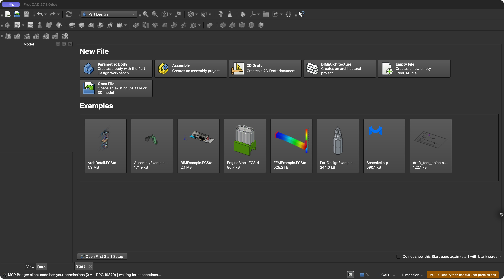
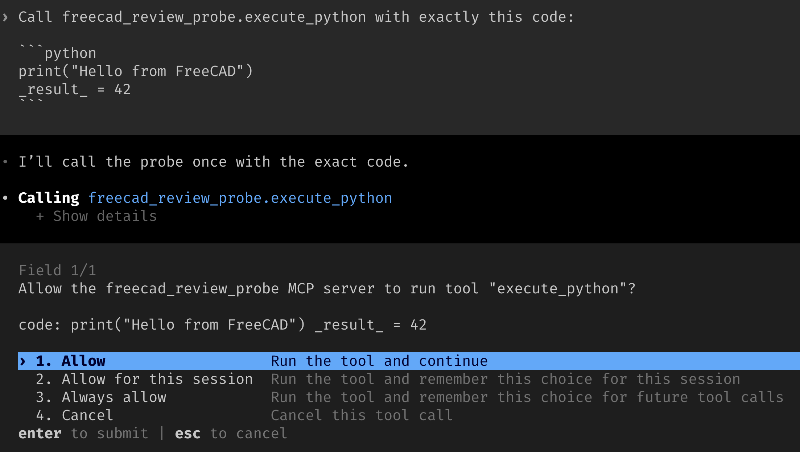
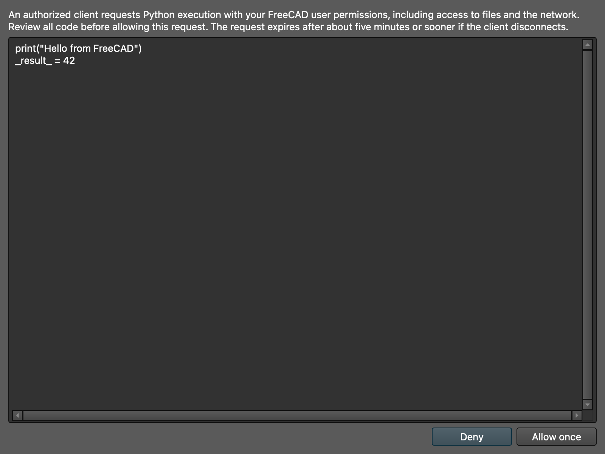
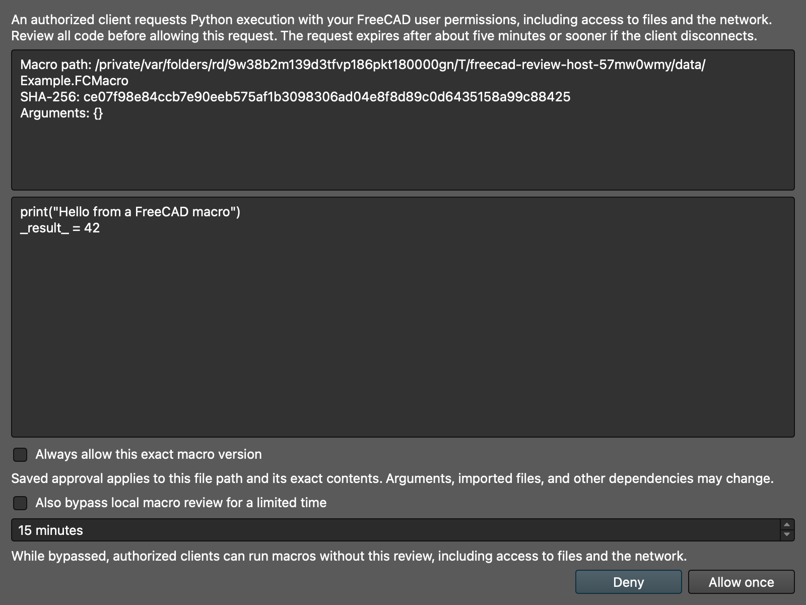
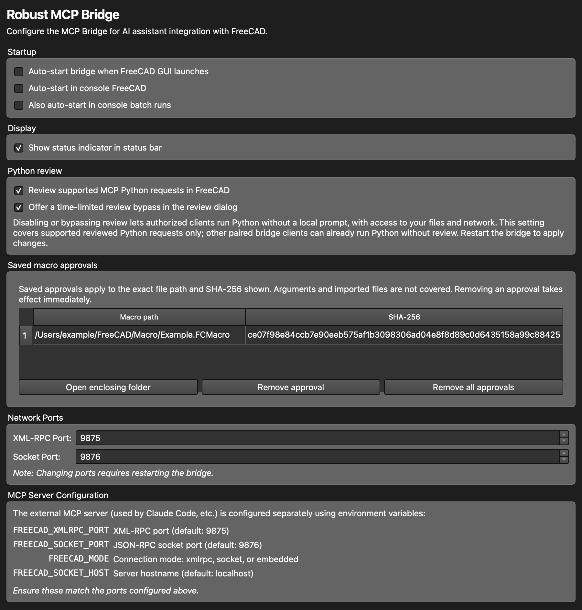

# Security

The Robust MCP Bridge runs inside FreeCAD. A paired client can submit Python
that runs with the FreeCAD user's permissions, including access to files and
the network. Use a client and models you trust, review its approval settings,
and stop the bridge when you are finished.

!!! note "Availability"
    The persistent permissions warning and the advisory tool annotations
    described below are available in the current development version. Check
    your installed release for its actual behavior.

## The FreeCAD warning

When the GUI bridge is running, an amber status-bar indicator says that client
Python has full user permissions. Hover over the workbench indicator for the
bridge version, listener status, and details about access to files and the
network. The warning is non-modal and remains visible while other status
messages appear, so it does not interrupt automated workflows. A warning is
also shown when the bridge runs without the workbench status widget.

The example shows the standalone bridge in an isolated FreeCAD test profile;
the warning is at the bottom right. The workbench indicator also shows the
listener ports. Your theme and port numbers may differ.

The warning describes the bridge's capabilities. It does not mean a client is
currently connected or that code is being executed. It remains appropriate
even when the MCP server's arbitrary-code tools are disabled: ordinary modeling
tools generate Python, and a paired client can communicate with the bridge
directly. Headless FreeCAD has no GUI status bar; check its startup output and
stop the process when it is no longer needed.

## Pairing and local connections

In workbench 0.7.0 and later, the bridge's XML-RPC and JSON-RPC listeners bind
to loopback and require a per-user pairing credential. Older 0.6.x bridges do
not provide pairing authentication; update both components to compatible
versions. Auto-start is disabled by default. Pairing keeps
clients without the credential from making authenticated requests; it does not
protect against malicious software running as the same operating-system user,
or against a paired agent following malicious instructions in a document.

Run `freecad-mcp --pair-bridge` before starting the bridge, and protect the
credential as described in [configuration](../getting-started/configuration.md#pairing-the-freecad-bridge).
If a credential is compromised, stop both components and replace it using the
instructions there. Pairing fails closed when valid credentials are unavailable.

In the current development version, the XML-RPC listener also rejects requests
with a browser `Origin` header or a non-loopback `Host` header. This reduces
exposure to browser requests and DNS rebinding; it does not replace pairing.
SSH forwarding remains possible when the client connects to a loopback host,
including on a different local port.

## Tools, files, and approvals

The MCP server hides `execute_python`, `safe_execute`, `run_macro`,
`create_macro`, and `create_macro_from_template` by default. Setting
`FREECAD_ALLOW_UNSAFE_CODE=true` before starting the server exposes them. This
is a tool-registration setting, not a Python sandbox or a bridge access control.
Other tools can read or write files and modify FreeCAD documents; enable unsafe
tools only when you need them and trust the client.

In the current development version, `execute_python` and `safe_execute`
require a local FreeCAD review dialog by default when using the socket
connection. A user can explicitly change this in the preferences below. The
dialog displays the code to be executed and defaults to denial. These tools
fail closed with older bridges, headless FreeCAD, embedded mode, and XML-RPC;
they do not fall back to unreviewed execution. `run_macro` also requires a
supported GUI/socket bridge and local review unless the user explicitly grants
a saved approval or timed bypass. Macro creation still writes files, and
ordinary modeling and file tools can have side effects without this dialog.

Depending on its configuration, an MCP client may ask permission before it
calls the tool. In this example Codex shows a permission prompt for the
isolated test server:

This is the client's permission decision. It is separate from FreeCAD's
review, may be disabled or remembered in client settings, and must not be
assumed to display all code in every client or configuration.

When an agent calls `execute_python`, the local review can look like this:

The image was captured with an MCP test client and a temporary FreeCAD profile.
The dialog shows the code to review, warns about its permissions, and defaults
to **Deny**. **Allow once** approves only that request; closing the dialog or
letting the review expire denies it. Review the complete code, including text
outside the initial view, before deciding.

### Macro review and saved versions

When an agent requests `run_macro`, FreeCAD captures the macro file, displays
its resolved path, SHA-256, arguments and code, and asks for a decision:

This screenshot shows a harmless example in an isolated FreeCAD profile, with
the optional timed bypass enabled. **Deny** stops the request; **Allow once**
runs the captured contents. Even if the file changes while the dialog is open,
FreeCAD executes the captured text that was displayed, rather than reopening
the file. CRLF line endings are shown and executed as LF. A changed file requires a new review unless an active
macro bypass or another saved approval applies.

**Always allow this exact macro version** saves an approval for the displayed
path and SHA-256. Later requests for that same path and contents can run without
another local review. This approval does **not** bind arguments, imported
modules, other files, or network resources; they may change the macro's behavior.
Use it only for macros and dependencies you trust. An enabled timed bypass is
separate: it skips review for *all* supported macro requests during that period,
including previously unseen macros.

Manage saved versions under **Preferences → Robust MCP Bridge → Saved macro
approvals**. Select an entry to remove it or open its containing folder; you
can also remove all entries. The screenshot shows an example entry:

Removal takes effect immediately, including for an automatic approval that has
not yet been claimed for execution. Saved approvals persist across bridge
restarts. The timed bypass lasts only for the selected interval and is cleared
when the bridge stops; the status indicator reports a macro bypass while active.

An explicit denial returns `ReviewDenied`; an unavailable review returns
`ReviewUnavailable`. Neither authorizes execution. Do not automatically retry
or bypass a user's denial.

For `safe_execute`, the dialog displays the complete transaction and validation
wrapper. The submitted code appears inside its `user_code` string, where quotes
and backslashes may be escaped. Review the wrapper and the submitted code;
deny the request if you cannot determine what it will execute.

In FreeCAD's Robust MCP Bridge preferences, **Review supported MCP Python
requests in FreeCAD** is enabled by default. It covers `execute_python` and
`safe_execute` together; the bridge cannot independently verify which MCP tool
supplied the Python. Disabling it allows these requests to proceed without the
local review dialog. Authorized clients' Python has your full permissions.

You may separately enable **Offer a time-limited review bypass in the review
dialog**. When enabled, the dialog offers an optional duration from one minute
to eight hours; selecting it and allowing the current request bypasses review
for subsequent supported requests of the same kind until it expires. Python
and macro bypasses are separate. The bypass is local to the running bridge and
is cleared when it stops. The status indicator shows which review is bypassed. Preference changes require a
bridge restart. The socket and GUI requirements still apply; this does not
enable reviewed execution in headless, XML-RPC, or embedded modes.
On macOS and Linux the bypass deadline includes time spent asleep. Platforms
without a sleep-inclusive clock use their monotonic clock, which may pause
during sleep; stop the bridge to end a bypass immediately.

The review rejects code or macro contents that cannot be displayed faithfully,
including certain control or formatting characters and code over the review
size limit. Macro CRLF line endings are displayed and executed as LF; the
saved checksum still identifies the original file bytes. Python review rejects
CRLF line endings. The socket's encoded request limit can be reached with
smaller input, depending on its content and authentication proof. Convert line
endings to LF before submitting the request;
the bridge displays and executes the submitted content without silently
rewriting it.

This is a guard on those MCP tools, not a bridge-wide policy: another paired
client can still submit Python directly to the bridge, and ordinary tools use
that same unrestricted bridge capability. A review cannot stop code that has
already started. A lost connection after committing an approved operation can
leave its outcome unknown; the server does not replay that operation.

Some code and file tools advertise MCP annotations describing their potential
effects. These annotations are advisory: clients decide whether and how to
present an approval, and a client may truncate code or automatically approve
a call. Check your client's actual approval behavior and review sensitive
operations and code before allowing them. See the
[tool risk inventory](../development/bridge-security-design.md#mcp-tool-risk-inventory-and-approval-boundaries)
for details and tested client behavior.

## Data leaving the machine

The workbench does not itself choose or contact an AI provider. Your MCP
client may send document contents, screenshots, tool results, or prompts to
its configured provider. Check the client's settings and provider policy
before opening sensitive material. Documents and tool results can also contain
instructions intended to mislead an agent; pairing does not make that content
trustworthy.

The bridge is loopback-only. The MCP server's optional HTTP transport is a
separate endpoint: it requires a bearer key and defaults to loopback. For remote
HTTP access, use a trusted TLS-terminating proxy and protect the key. See
[HTTP authentication](../getting-started/configuration.md#http-authentication)
and [connection modes](connection-modes.md#security-boundary). Do not expose
the bridge by rebinding it to a public interface.

## Practical precautions

- Keep FreeCAD, the workbench, server, and client updated; FreeCAD 1.1.4 or
  newer is recommended when opening untrusted files.
- Review client approval and automatic-execution settings before connecting.
- Use only models and macros you trust, and review requested file operations.
- Leave arbitrary-code tools disabled unless needed.
- Stop the bridge when it is not in use and rotate a compromised pairing.
