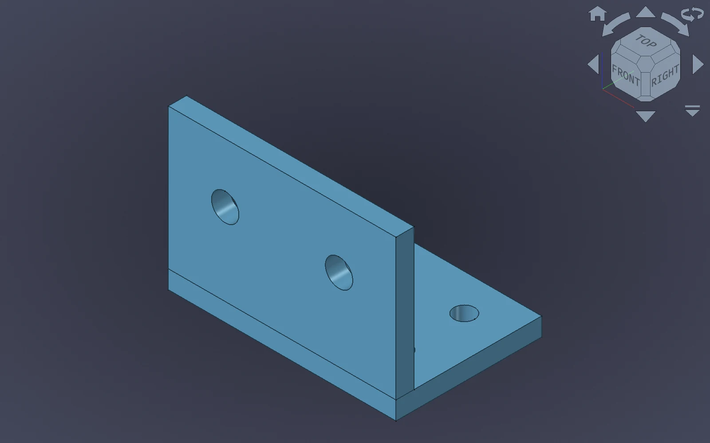
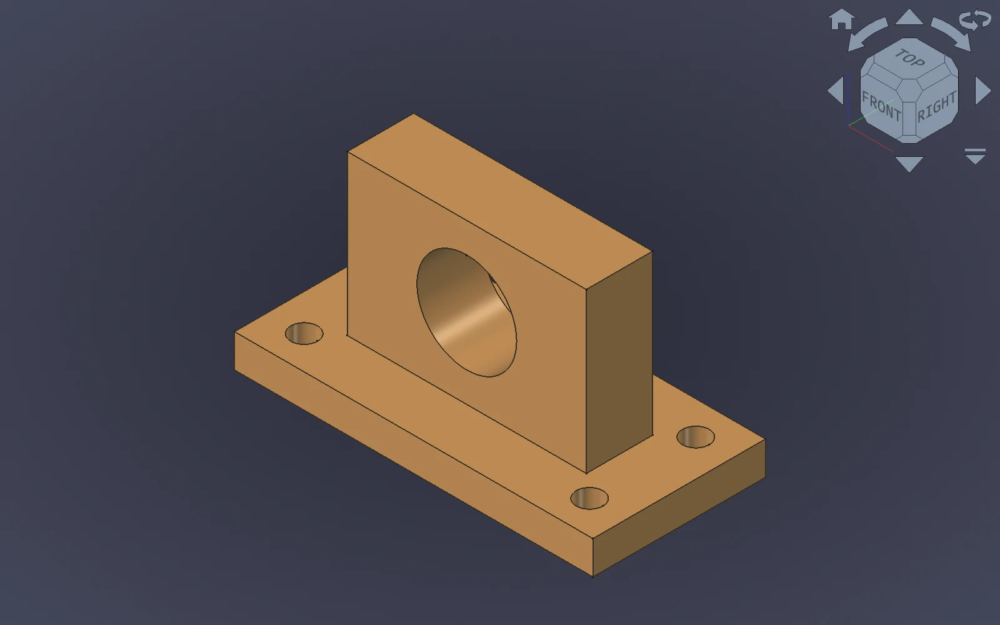

---
hide:
  - toc
---

# Build in FreeCAD with your AI assistant

FREECAD + MODEL CONTEXT PROTOCOL

## From an idea to a model, together

Give your MCP-compatible assistant a direct connection to FreeCAD. Create and
inspect geometry, explore a design, and export your work while keeping FreeCAD
at the center of the workflow.

[Quick start](getting-started/quickstart.md){ .md-button .md-button--primary }
[Explore the tools](guide/tools.md){ .md-button }

Open source · Local-first connection · GUI and headless modes

EXAMPLE MODEL · FREECAD 3D VIEW

A PRACTICAL CAD COMPANION

## Work in the tools you already use

The server exposes FreeCAD operations to your assistant; the bridge workbench
runs inside FreeCAD and carries out those operations.

### Create and edit

Build primitives and PartDesign features, combine geometry, and work with
documents and objects through natural-language requests.

### Inspect and iterate

Ask about objects and properties, adjust a model, and capture views in FreeCAD's
GUI to review the result as you work.

### Export and automate

Prepare STEP, STL, and other supported exports, or use headless FreeCAD for
workflows that do not need a visible 3D view.

EXAMPLE MODEL · FREECAD 3D VIEW

IDEAS TO TRY

## Start with a useful request

- “Create a mounting bracket with four bolt holes.”
- “Inspect this part and tell me its dimensions and volume.”
- “Export the current model to STEP and STL.”
- “Show an isometric view and capture a screenshot.”

These are example requests; review the generated geometry and dimensions
before using a model for manufacturing.

[See the quick start](getting-started/quickstart.md) · [View all tools](guide/tools.md)

GET CONNECTED

## Three pieces, one workflow

### 01 · Install

Install the MCP server and the Robust MCP Bridge workbench in FreeCAD. The
[quick start](getting-started/quickstart.md) walks through both installations.

### 02 · Pair and start

Run `freecad-mcp --pair-bridge`, then start the bridge in FreeCAD.

### 03 · Connect your assistant

Configure an MCP-compatible client and start with a small request.

### See when the bridge is running

The workbench toolbar starts and stops the bridge. Its status indicator shows
when the local connection is available.

[Workbench guide](guide/workbench.md) · [Connection and security settings](getting-started/configuration.md)

## Ready to connect?

Follow the quick start to set up FreeCAD, the bridge, and your MCP client.

[Get started](getting-started/quickstart.md){ .md-button .md-button--primary }
[View on GitHub](https://github.com/spkane/freecad-addon-robust-mcp-server){ .md-button }

